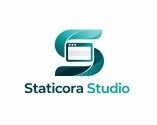

 

<h4 align="center">
  Creo aplicaciones multiplataforma útiles y sencillas. Colaboro también con otros desarrolladores en aplicaciones que hagan nuestra vida un poquito mejor. La tecnología digital tiene que ser fácil de usar para todos. Si no lo es, no sirve para nada.
</h4>

 

---

 

<h4 align="center">En qué trabajo</h4>

 
<table>
  <tr>
    <td width="90" align="center">
      
    </td>
    <td>
      <b>5anHour</b> 
      Una aplicación para mantener el cuerpo activo en la oficina (o donde quieras) ¡Visita <a href="https://5anHour.com"><kbd>5anHour.com</kbd></a> para descargarla!
    </td>
  </tr>
</table>

 

<table>
  <tr>
    <td width="90" align="center">
      
    </td>
    <td>
      <b>Staticora Studio</b> 
      Una agencia de creación de aplicaciones y páginas web para empresas y particulares en colaboración con <a href="https://github.com/DevPGSV"><kbd>DevPGSV</kbd></a>. Puedes ver nuestros proyectos (y contratarnos 😜) en <a href="https://staticorastudio.com"><kbd>StaticoraStudio.com</kbd></a>
    </td>
  </tr>
</table>

 

